# Implementation Plan: Artwork Enrichment for Albums and Singles

Enrich missing artwork across both incoming media (`intake.py`) and the existing library (`/media/jack/buffer/audio`), adhering strictly to the player contract, audio hash invariance, and the architectural distinction between album directories and loose singles.

---

## User Review Required

> [!IMPORTANT]
> **Album Folders vs. Loose Singles Architecture:**
> 1. **Albums (`cover.jpg` in directory):** Albums (both complete and incomplete) always reside in their own folder (`<Bucket>/<Artist>/<Artist> - <Album> (<Year>)/`). We will store artwork as `cover.jpg` in the folder. This touches **zero audio bytes**, preserves `audio_hash` across all formats, avoids library bloat, and fully satisfies the player.
> 2. **Singles (Embedded in tags):** Loose tracks in `<Bucket>/<Artist>/0singles/` share a common folder. Storing `cover.jpg` in `0singles/` would collide across all singles in that directory. Therefore, singles require **embedded artwork** (ID3v2.4 `APIC`, FLAC `METADATA_BLOCK_PICTURE`, MP4 `covr`).
> 3. **Hash Safety Warning for Singles:** For MP3, FLAC, and M4A, `audio_hash` skips tags and remains stable. However, for Ogg/Opus/WMA, the whole file is hashed; embedding art changes their hash. The plan will default to skipping embedded art on Ogg/Opus/WMA singles unless explicitly forced.

> [!WARNING]
> **Beets Limitation:**
> Beets' built-in `fetchart` plugin **only processes full album imports** (`task.is_album`). It completely ignores singletons during import. Therefore, while Beets handles album artwork during `intake.py`, our custom tooling must handle existing album backfills where Beets DB is not used, as well as all loose singles.

---

## Key Questions Answered

### 1. Does Beets only do albums?
* **Audio tagging:** Beets supports both albums (`beet import`) and singletons (`beet import -s`).
* **Artwork fetching (`fetchart`):** **Yes, Beets `fetchart` only does albums.** The `fetchart` plugin source code explicitly ignores singletons (`if task.is_album: ...`).
* **Conclusion:** We can leverage Beets `fetchart` for album imports in `intake.py`, but cratedigger needs its own CAA fetcher for existing library backfill and for loose singles.

### 2. Which type should we do? Embedded in MP3 or `cover.jpg` in album folder?
* **Albums (Full & Incomplete):** **`cover.jpg` file in the album folder.**
  * Incomplete albums still have their own album directory under the Tier 1 contract.
  * A single `cover.jpg` serves all tracks in that album without rewriting audio bytes or bloating storage.
  * 100% hash-safe for `features.pkl` and remote player sync.
* **Singles (`0singles/`):** **Embedded front cover.**
  * Since multiple tracks share `<Artist>/0singles/`, folder art cannot differentiate them.

### 3. Is there a different approach for albums vs. singles?
* **Yes:**
  | Property | Album Folders | Loose Singles (`0singles/`) |
  | :--- | :--- | :--- |
  | **Storage Location** | `cover.jpg` in folder | Embedded in audio tags |
  | **Player Support** | Player reads `cover.jpg` directly | Player extracts embedded APIC |
  | **Audio Bytes Modified** | None (100% hash-safe) | File tag headers updated |
  | **API Query Target** | CAA Release ID (`mb_albumid`) or Release Group (`mb_releasegroupid`) | CAA Release ID of the single/recording |
  | **Tooling** | Beets `fetchart` (intake) + Script fetcher (backfill) | Mutagen-based embedding via script |

---

## Architecture & Workflow

```mermaid
flowchart TD
    subgraph IntakeFlow["New Arrivals (intake.py)"]
        IN[Incoming Files] --> B_IMP["Beets Import (config/beets.yaml)"]
        B_IMP -->|fetchart| ART_ALBUM["Fetches cover.jpg for Albums"]
        ART_ALBUM --> REN["02_rename.py & 03_folders.py"]
        REN --> MOV["04_move.py --to-artist-root"]
        MOV --> S_CHK{"Is Album or Single?"}
        S_CHK -->|Album| D_ALB["<Artist>/<Album>/cover.jpg moved intact"]
        S_CHK -->|Single in 0singles| EMB_POST["Post-intake: Embed CAA art into single"]
    end

    subgraph BackfillFlow["Existing Library Backfill (scripts/enrich_covers.py)"]
        AUD["Scan Library Folder / Bucket"] --> DET{"Missing Art?"}
        DET -->|No cover.jpg in Album Folder| CAA_ALB["Fetch CAA front cover (1200px)"]
        CAA_ALB --> W_COV["Write <album_dir>/cover.jpg"]
        DET -->|Single in 0singles missing APIC| CAA_SNG["Fetch CAA single art"]
        CAA_SNG --> W_EMB["Embed into tag (mutagen)"]
        DET -->|Unresolvable| REV["Log to review.json"]
    end
```



---

## Proposed Changes

### Component 1: Beets Configuration (`config/beets.yaml`)

#### [MODIFY] [`config/beets.yaml`](file:///home/jack/Projects/cratedigger/config/beets.yaml)
* Add `fetchart` to plugins list.
* Add `art_filename: cover` to ensure destination artwork is named `cover.ext`.
* Configure `fetchart` parameters:
  - `auto: yes`
  - `cautious: yes`
  - `cover_names: [cover, front, folder, albumart]` (finds existing local art before querying APIs)
  - `sources: filesystem coverart itunes amazon`
  - `maxwidth: 1200`
  - `enforce_ratio: yes`
  - `cover_format: JPEG` (guarantees converted JPEG output for player compatibility)

```yaml
art_filename: cover

plugins:
  - musicbrainz
  - chroma
  - fromfilename
  - info
  - fetchart

fetchart:
  auto: yes
  cautious: yes
  cover_names:
    - cover
    - front
    - folder
    - albumart
  sources:
    - filesystem
    - coverart
    - itunes
    - amazon
  maxwidth: 1200
  enforce_ratio: yes
  cover_format: JPEG
```

---

### Component 2: Cover Art Archive Client in [`lib/mb.py`](file:///home/jack/Projects/cratedigger/lib/mb.py)

#### [MODIFY] [`lib/mb.py`](file:///home/jack/Projects/cratedigger/lib/mb.py)
* Add wrapper functions to fetch front cover binary data from Cover Art Archive with rate-limiting and backoff:
  - `fetch_caa_cover(release_id: str, size: str = "1200") -> bytes | None`
  - `fetch_caa_release_group_cover(release_group_id: str, size: str = "1200") -> bytes | None`
  - `search_release_mbid(artist: str, album: str) -> tuple[str | None, str | None]` (fallback lookup returning `(release_id, release_group_id)` for untagged albums)
* **Crucial Error-Handling Rule**: In `musicbrainzngs`, `ResponseError` is a subclass of `WebServiceError`. When Cover Art Archive returns HTTP 404 (no artwork exists for this release/group) or 400 (bad UUID), the client must **not** treat it as transient and must **not** retry with exponential backoff (which would waste 7 seconds per album). Instead, inspect `getattr(exc.cause, "code", None)` and immediately return `None` when code is 404 or 400.

---

### Component 3: Tag & Embedded Art Helpers in [`lib/tags.py`](file:///home/jack/Projects/cratedigger/lib/tags.py)

#### [MODIFY] [`lib/tags.py`](file:///home/jack/Projects/cratedigger/lib/tags.py)
* Add `has_embedded_artwork(path: Path) -> bool`:
  - Inspect mutagen structures:
    - MP3: check for ID3 `APIC` frame.
    - FLAC: check `audio.pictures`.
    - M4A: check `audio.tags["covr"]`.
    - Ogg/Opus: check `metadata_block_picture`.
    - WMA: check `WM/Picture`.
* Add `embed_artwork(path: Path, image_bytes: bytes, mime_type: str = "image/jpeg", *, dry_run: bool = True, force: bool = False) -> bool`:
  - Default to `dry_run=True` (consistent with cratedigger contract).
  - Embed front cover (`APIC` type 3 in ID3, `Picture` type 3 in FLAC, `MP4Cover` in MP4).
  - **Audio Hash Safety**: For MP3, FLAC, and M4A, tag changes skip audio data and preserve `audio_hash`. For Ogg/Opus/WMA, the entire file is hashed. Refuse to embed on Ogg/Opus/WMA unless `force=True` to preserve track identity and remote sync state.

---

### Component 4: Library Backfill & Audit Script (`scripts/enrich_covers.py`)

#### [NEW] [`scripts/enrich_covers.py`](file:///home/jack/Projects/cratedigger/scripts/enrich_covers.py)
* Command-line utility for scanning and enriching missing artwork across the library:
  - Flags: `--dry-run` (default: True), `--no-dry-run`, `--folder <path>`, `--bucket <A-Z>`, `--singles`, `--albums-only`, `--max-size 1200`, `--force-lossy-hash`, `--log <path>`.
* **Pillow Image Processing Helper**:
  - `process_image(data: bytes, max_size: int = 1200) -> tuple[bytes, str]`: Validates image data, reformats non-JPEGs and transparency (RGBA/P -> RGB) to clean standard JPEG (`quality=90`), and scales down proportionally if width or height exceeds `max_size`.
* **Album Processing Flow**:
  1. Check if folder contains audio and has no valid `cover.jpg` or `folder.jpg`.
  2. If [`select_cover_candidate()`](file:///home/jack/Projects/cratedigger/scripts/normalize_covers.py) finds a local image (`front.jpg`, `cover.jpeg`), normalize it first via [`normalize_cover_in_folder()`](file:///home/jack/Projects/cratedigger/scripts/normalize_covers.py).
  3. If no local image exists:
     - Read audio tags from the first audio track for `mb_albumid` or `mb_releasegroupid`.
     - If missing, fall back to `search_release_mbid(artist, album)`.
     - Fetch CAA cover bytes (`fetch_caa_cover`, fallback to `fetch_caa_release_group_cover`).
     - Process with Pillow (reformat to JPEG, scale to max 1200px).
     - Write `cover.jpg` (or log proposed write in dry-run).
* **Singles Processing Flow (when `--singles` is passed)**:
  1. Scan tracks in `0singles/`.
  2. If `has_embedded_artwork(track)` is False:
     - Read tags for `mb_albumid` or `mb_trackid`.
     - Fetch CAA art, process with Pillow, and embed via `embed_artwork()`.
* Logs summary and writes deduplicated unresolvable items to `review.json`.

---

### Component 5: Intake Pipeline Integration in [`intake.py`](file:///home/jack/Projects/cratedigger/intake.py)

#### [MODIFY] [`intake.py`](file:///home/jack/Projects/cratedigger/intake.py)
* With `fetchart` enabled in `config/beets.yaml`, Beets automatically fetches `cover.jpg` for album imports into `incoming/`.
* Integrate `scripts/enrich_covers.py` as a pipeline stage on `incoming/` between Beets import and `02_rename.py` (or post-import):
  - Enriches albums that Beets `fetchart` missed.
  - Automatically enriches loose singles with embedded artwork before they are renamed and moved to `<Bucket>/<Artist>/0singles/`.
* Update [`tests/test_intake_layout_ownership.py`](file:///home/jack/Projects/cratedigger/tests/test_intake_layout_ownership.py) to assert the updated command pipeline.

---

## Verification Plan

### Automated Tests
Run unit tests verifying both mock CAA network operations and tag/file writes:
```bash
.venv/bin/python -m unittest tests/test_tags_artwork.py
.venv/bin/python -m unittest tests/test_enrich_covers.py
.venv/bin/python -m unittest tests/test_normalize_covers.py
.venv/bin/python -m unittest tests/test_intake_layout_ownership.py
.venv/bin/python -m unittest discover -s tests
```

Specific test scenarios:
1. `test_has_embedded_artwork`: Correctly detects existing APIC / FLAC picture blocks / MP4 covr.
2. `test_embed_artwork_hash_safety`: Verifies MP3, FLAC, and M4A `audio_hash` is completely identical before and after embedding; verifies Ogg/Opus/WMA is rejected without `force=True`.
3. `test_caa_404_no_retry`: Verifies HTTP 404 from CAA returns `None` immediately without entering exponential backoff retries.
4. `test_enrich_album_cover_dry_run`: Validates proposed `cover.jpg` creation without touching disk.
5. `test_enrich_album_cover_live`: Downloads mocked CAA image, converts PNG to JPEG, resizes down to 1200px, and verifies `cover.jpg` is written.
6. `test_intake_pipeline_flow`: Verifies `intake.py` invokes the cover enrichment stage.

### Manual Verification
1. Test Beets import trial on a single incoming album:
   ```bash
   .venv/bin/python -m beets -c config/beets.yaml import --pretend /path/to/incoming/album
   ```
2. Test dry-run of cover enrichment on a target test folder:
   ```bash
   .venv/bin/python scripts/enrich_covers.py --dry-run --folder "A/Arcade Fire"
   ```
3. Inspect `cover.jpg` creation and verify image opens in standard viewers.
